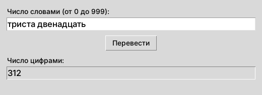

# ДЗ-1 по РИСП: число прописью → цифрами (русский язык)

Домашнее задание № 1 по дисциплине «Разработка инструментальных средств программирования» (преподаватель Корягин С. В.).

**Задание.** На вход письменно подаётся любое число от 0 до 999. Необходимо вывести это число в цифровом виде либо указать ошибки ввода во всплывающем окне. Приложение графическое.
**Вариант:** 4 — русский язык.



## Запуск
Нужен только Python 3.12+ (с tkinter — при установке на Windows галочка «tcl/tk and IDLE»).

```
python dz1_chislo_propisyu_gotovo.py        # окно программы
python dz1_chislo_propisyu_gotovo.py test   # самопроверка (все числа 0–999 и ошибки)
```
На Windows можно просто дважды щёлкнуть `run.bat`.

## Файлы
| Файл | Что это |
|---|---|
| `dz1_chislo_propisyu_gotovo.py` | Полная версия: однопроходный транслятор, функции = предложения БНФ |
| `dz1_tetrad.py` | Короткая версия (табличный разбор) |
| `schemes/` | Блок-схемы (PNG и общий PDF) |

## Формальное описание (БНФ)
```
Число   = "ноль" ! Сотни </ Хвост /> ! Хвост
Хвост   = Десятки </ Единицы /> ! Надцать ! Единицы
Сотни   = "сто" ! "двести" ! . . . ! "девятьсот"
Десятки = "двадцать" ! "тридцать" ! . . . ! "девяносто"
Надцать = "десять" ! "одиннадцать" ! . . . ! "девятнадцать"
Единицы = "один" ! "два" ! . . . ! "девять"
```

## Устройство
Транслятор однопроходный: лексический анализ (проверка слова по словарю) выполняется в момент, когда до слова дошёл синтаксический анализ. Поэтому диагностика работает **до первой ошибки** и всегда указывает первую по тексту ошибку — её тип и место.

| Ввод | Результат |
|---|---|
| `триста двенадцать` | 312 |
| `девятьсот девяносто девять` | 999 |
| *(пусто)* | Введите число словами |
| `семь сот` | Ошибка в 2-м слове (сот): такого слова нет! |
| `пять двадцать` | После единиц (пять) не могут идти десятки (двадцать)! |
| `тринадцать три` | После чисел 10–19 (тринадцать) не могут идти единицы (три)! |
| `ноль пять` | После нуля (ноль) не могут идти единицы (пять)! |
| `пять двадцать сот` | После единиц (пять) не могут идти десятки (двадцать)! |

## Блок-схемы
1. По кнопке «Перевести» · 2. Перевести · 3. Число · 4. Хвост · 5. Слово i (лексический анализ) · 6–9. Сотни, Десятки, Надцать, Единицы — см. `schemes/`.
